  

<h3 align="center">LLMs · RAG · Agents</h3>

# Roland Fontanes

**Data Scientist | AI Engineer | LLM & RAG Systems**

Final-year engineering student in Data & AI at **EFREI Paris** (class of 2027).

---

## About

I build AI systems that turn messy, scattered information into something people can actually use, from document pipelines to LLM-powered assistants.

My approach:

- **Applied AI first**: LLMs, RAG and agents designed around a real workflow, not a demo
- **Solid data foundations**: clean ingestion, reliable pipelines, measurable results
- **Understand how things work**: I like implementing algorithms from scratch when it matters (see the YIN pitch detector in ClarinHelp)

---

## Professional Experience

### Data Scientist Intern — Ateme
*Vélizy-Villacoublay, France · Nov 2025 – Mar 2026*

**Key Contributions**

- Built a pipeline to integrate **SharePoint** content into the internal **AI chatbot**
- Designed **intelligent agents** to automate tasks and improve team productivity
- Prototyped and integrated **LLMs** to enhance the chatbot's capabilities

---

## Projects

### 🎵 ClarinHelp
A practice companion for beginner clarinettists, running in the browser.
🔗 https://github.com/Roland165/ClarinHelp

**Highlights**

- Real-time tuner showing the written B♭ clarinet note and cents deviation
- **YIN pitch detection** implemented from scratch in TypeScript, running in an AudioWorklet
- Median filtering, smoothing and an adaptive silence threshold for a stable needle
- Python side (uv + pytest) for offline evaluation and future model training

### 🤖 Azure Chatbot Template
A chatbot that answers questions about your own documents, using a RAG pipeline on Azure OpenAI.
🔗 https://github.com/Roland165/Azure-Chatbot-Template

**Highlights**

- Ingests PDF, TXT, Markdown and HTML files and builds a **FAISS** vector index
- **GPT-4o** + `text-embedding-3-large` via Azure OpenAI
- **FastAPI** `/ask` endpoint and a **Streamlit** chat interface
- Configurable chunking and limits through environment variables

---

## Technical Skills

  

### AI & LLMs
- RAG, agents, LangChain, Hugging Face
- Azure AI Foundry, Azure OpenAI

### Machine & Deep Learning
- scikit-learn: regression, trees, random forest, SVM, KNN, K-Means, PCA
- PyTorch: CNN, transfer learning, Transformers

### Data
- Python (NumPy, pandas), SQL
- MySQL, MongoDB, Redis, Cassandra, Elasticsearch, Neo4j
- Power BI, Microsoft Fabric

### Engineering
- C, Java, Scala, JavaScript / TypeScript (Vue.js, Next.js)
- Git, GitHub, GitLab

---

## Languages

French (native) | English (C1, TOEIC 970) | German (A2) | Hungarian (beginner)

---

## Portfolio

🌐 https://roland-fontanes.vercel.app

---

## Career Objective

Seeking an **internship in Data Science / AI starting April 2027**, in France or abroad.

---

## Contact

- LinkedIn: https://www.linkedin.com/in/roland-fontanes/
- Portfolio: https://roland-fontanes.vercel.app
- Email: roland.fontanes@efrei.net
- GitHub: https://github.com/Roland165
