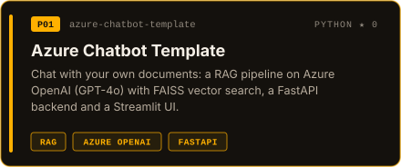
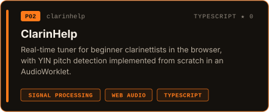
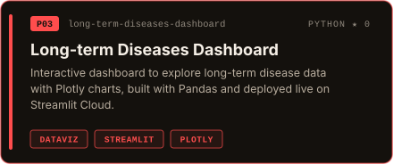
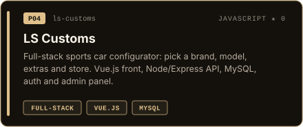

  

  

  
  
  
  

## About

I'm a final-year engineering student in **Data & AI at EFREI Paris** (class of 2027). I'm driven by curiosity: I like understanding how systems work, then applying it to real problems, from ML models and data pipelines to LLM-powered apps.

- **Recently:** Data Scientist intern at **Ateme**. SharePoint → AI chatbot pipeline, LLM agents automating team tasks
- **On the side:** a RAG chatbot template on Azure OpenAI, and a clarinet tuner with pitch detection built from scratch
- **Off-screen:** clarinet (classical, klezmer, jazz) and tennis
- **Next:** looking for a **Data Science / AI internship from April 2027**, in France or abroad. [Get in touch](mailto:roland.fontanes@efrei.net)

## Stack

**AI & LLMs** 

**Machine & Deep Learning** 

**Data & databases** 

**Cloud & BI** 

**Backend & web** 

**Tooling & deployment** 

## Projects

  
  

  
  

## Languages

French (native) · English (C1, TOEIC 970) · German (A2) · Hungarian (beginner)
